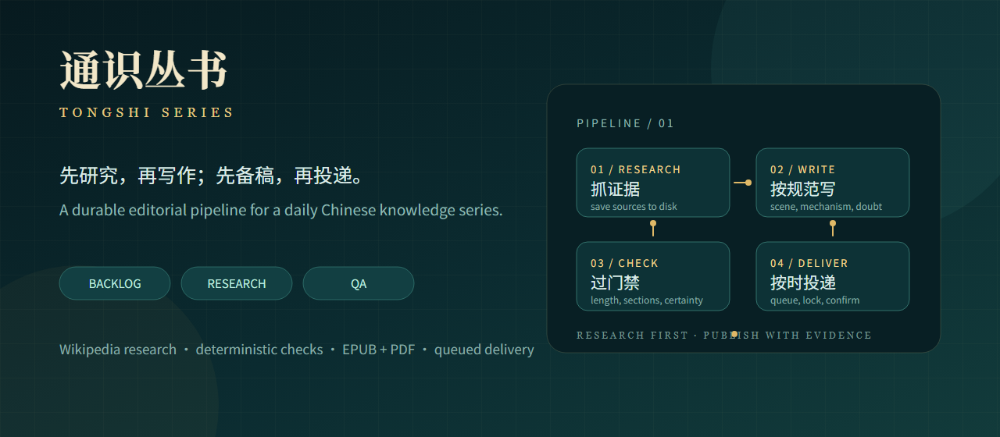

# Tongshi Series

一个用于持续生产中文通识长文的 Codex skill（v0.1.0 public beta）：先研究，再写作；先备稿，再投递；每一篇都能追溯到资料、字数、成品和发布状态。

它解决的不是“让模型写一篇文章”，而是把“每天都能稳定交出一篇像样的文章”拆成一套可检查的流程。研究和写作是前台，库存、队列、EPUB/PDF 和投递是后台。

在线介绍页：[ironsnake-change.github.io/tongshi-series](https://ironsnake-change.github.io/tongshi-series/) · 发布文案：[docs/promotion-kit.md](docs/promotion-kit.md)

## 为什么值得试用

- 研究先行：每篇先保存 Wikipedia 原文到 research.md，写不清的地方必须标成推测。
- 编辑门禁：字数、正文、章节、开头长度、确定性说明和术语表由脚本检查，不靠“感觉差不多了”。
- 写发分离：写作只补库存，投递按队列取稿；断网、重启或 Codex 未运行都不会让稿件状态自动漂移。
- 可读成品：同一份 Markdown 输出 EPUB 和 PDF，适合邮件、阅读器和归档。
- 队列有身份：meta.json 记录 queued_at，不再依赖目录名猜先后。
- 可运营：库存脚本、失败日志、幂等投递和定时任务都有明确接口。

适合：想长期维护一个主题型博客、邮件通讯、读书会材料或内部知识专栏的人。

不适合：只需要一次性文章、没有编辑标准、或希望自动发布却不愿检查事实来源的人。

## 工作流

~~~mermaid
flowchart LR
    A[选题与领域轮转] --> B[抓取 research.md]
    B --> C[按编辑规范写 article.md]
    C --> D[validate_article.py]
    D -->|失败| C
    D -->|通过| E[生成 EPUB / PDF]
    E --> F[加入 meta.json 队列]
    F --> G[独立投递任务]
    G --> H[写入 .sent 与日志]
~~~

默认库存目标是 4 篇待发。库存不足时，一轮最多写 3 篇；交付仍然由独立步骤触发。这样可以避免“到点才发现没稿”，也避免“为了补库存把质量压到不可交付”。

## 安装

把整个仓库放进 Codex skills 目录：

    git clone https://github.com/ironsnake-change/tongshi-series.git "$env:CODEX_HOME/skills/tongshi-series"

没有设置 CODEX_HOME 时，使用用户目录下的 .codex/skills/tongshi-series。

然后在一个空的系列目录里初始化：

    python "$env:CODEX_HOME/skills/tongshi-series/scripts/new_article.py" --root . --id sample-topic --domain "未知与边界" --title "一个具体的标题"
    python "$env:CODEX_HOME/skills/tongshi-series/scripts/research.py" "Tunguska event" "通古斯大爆炸" --out 2026-11-05-sample-topic/research.md

## 使用

在 Codex 里直接说：

    Use $tongshi-series to fill the backlog with two researched Chinese essays, without sending them.

或者分别运行质量门禁：

    python "$env:CODEX_HOME/skills/tongshi-series/scripts/validate_article.py" 2026-11-05-sample-topic/article.md
    python "$env:CODEX_HOME/skills/tongshi-series/scripts/inventory.py" --root . --pending-only

构建成品：

    python scripts/build_epub.py 2026-11-05-sample-topic/article.md 2026-11-05-sample-topic/文章.epub "标题" "Tongshi Series"
    python scripts/md_to_pdf.py 2026-11-05-sample-topic/article.md 2026-11-05-sample-topic/文章.pdf

PDF 脚本会自动寻找 Chrome、Edge 或 Chromium；找不到时设置 CHROME_PATH。

## 默认编辑标准

| 项目 | 默认值 |
|---|---|
| 全文汉字数 | 4000–4500 |
| 目标 | 4200 |
| 正文主体 | 不少于 4000 |
| 章节 | 10–15 节 |
| 单节 | 180–450 字 |
| 开头首段 | 不超过 120 字 |
| 术语表与延伸阅读 | 合计不超过 300 字 |
| 结尾 | 三档确定性说明 |

完整规则见 references/editorial-style.md，发布边界与测试证据见 references/release-review.md。它包含叙事节奏、材料分级、传说标注、数字区间、结尾写法和交付前自检。

## 可靠性设计

- 研究文件、正文、EPUB、PDF 全部落在同一目录，状态可以离线恢复。
- 目录有 article.md 且没有 .sent 才是待发；空目录和旧稿不会误入队列。
- 投递按 meta.json 的 queued_at 排序，失败时不跳稿，不重复发送。
- 发送成功后才写 .sent，并把结果写入日志。
- 质量门禁通过后才构建成品；结构化校验不能代替事实核查。
- 公开仓库不包含邮箱、SMTP 密钥、推送 topic 或个人路径。

## 已知边界

这是一套成熟的内部工作流，public beta 的发布包。默认研究源是 Wikipedia，适合作为起点，不足以代替一手档案和领域专家。PDF 生成依赖本地 Chromium。定时投递的邮件实现属于私有环境配置，不随公开包提供。

下一步计划：将队列的 queued_at 推广到旧目录、加入近似重复标题检测、补充英文版编辑规范，以及把 provider 路由做成显式配置。

## 参与

如果这套流程对你有用，点一个 Star，或者直接拿它改造你的主题系列。发现结构性问题、可复现的构建错误或 editorial gate 的盲区，欢迎开 issue。

## License

MIT. See [LICENSE](LICENSE).
